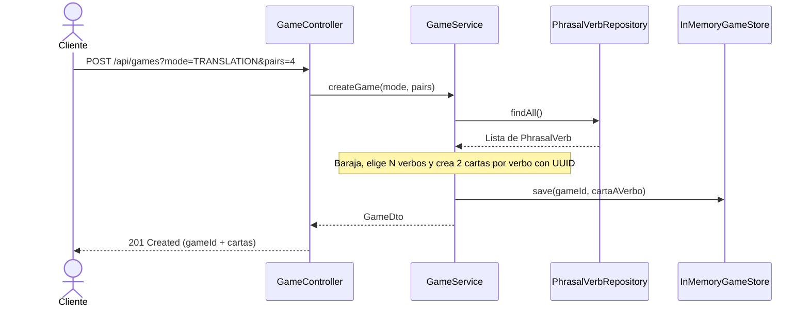
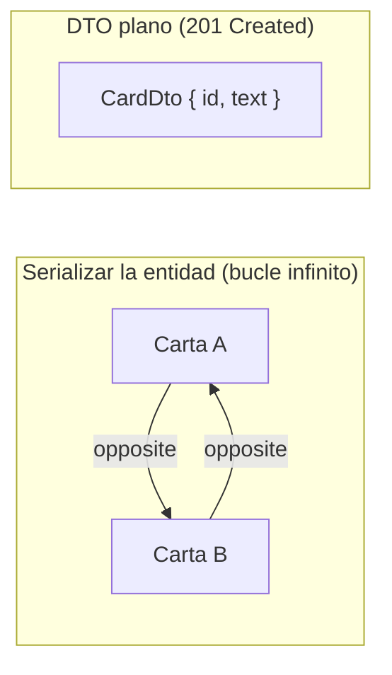
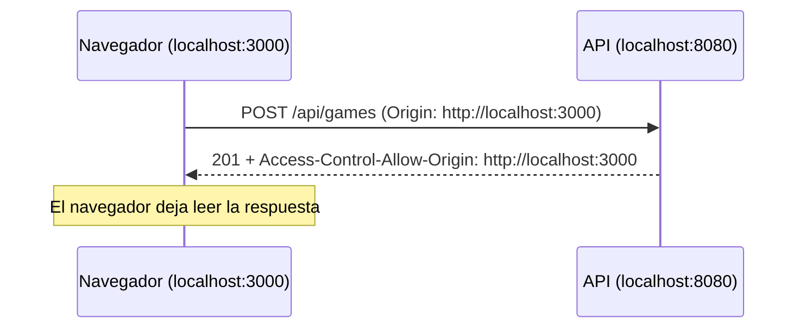

# 🃏 Phrasal Verbs Memory Game (Backend API)

API REST que alimenta un juego web de emparejamiento de cartas para aprender phrasal verbs en inglés (nivel B2). Está pensada para 4 modos de juego (opuestos, sinónimos, traducción y huecos); hoy está implementado el modo de **traducción**.

> **Estado:** en desarrollo. Backend con modelo de datos, creación de partidas, API de cartas y CORS para el frontend. Pendiente: validación de jugadas y resto de modos. El frontend está en un repositorio aparte: [phrasal-verbs-frontend](https://github.com/BryanDZV/phrasal-verbs-frontend).

## 🛠️ Stack

- Java 21
- Spring Boot 4.1 (Web, Data JPA, Validation, Lombok)
- PostgreSQL 16
- Docker y Docker Compose
- Maven

## 📋 Requisitos previos

- JDK 21
- Docker Desktop
- Git
- Un IDE para Java (IntelliJ IDEA, VS Code…)

## ⚙️ Configuración

1. Copia la plantilla de variables de entorno:

   ```bash
   cp .env.example .env
   ```

2. Edita `.env` y rellena tus valores:

   | Variable      | Descripción                                                  |
   | ------------- | ------------------------------------------------------------ |
   | `DB_NAME`     | Nombre de la base de datos                                   |
   | `DB_URL`      | URL JDBC (`jdbc:postgresql://localhost:<puerto>/<DB_NAME>`)  |
   | `DB_USER`     | Usuario de PostgreSQL                                        |
   | `DB_PASSWORD` | Contraseña de PostgreSQL                                     |
   | `CORS_ORIGIN` | Opcional. Origen del frontend autorizado por CORS. Si no se define, se usa `http://localhost:3000` |

   El puerto de `DB_URL` debe coincidir con el expuesto en `docker-compose.yml`.

3. Las variables de `.env` deben llegar a Spring como variables de entorno (`application.properties` las lee con `${DB_URL}`, `${DB_USER}`, etc.):

   - **En el IDE:** añádelas en la configuración de ejecución de la aplicación (en IntelliJ: *Run > Edit Configurations > Environment variables*, o con un plugin como EnvFile apuntando a `.env`).
   - **Por terminal:** exporta las variables antes de arrancar:

     ```bash
     set -a && source .env && set +a
     ```

## 🚀 Puesta en marcha

1. Clona el repositorio:

   ```bash
   git clone https://github.com/BryanDZV/phrasal-verbs-backend.git
   cd phrasal-verbs-backend
   ```

2. Levanta PostgreSQL:

   ```bash
   docker compose up -d
   ```

3. Arranca la aplicación:

   ```bash
   ./mvnw spring-boot:run
   ```

   En Windows (PowerShell o CMD): `mvnw.cmd spring-boot:run`

## ✅ Cómo comprobar que funciona

1. En la consola debe aparecer `Started PhrasalgameApplication in X seconds` sin errores de conexión.
2. Al arrancar por primera vez se cargan 6 phrasal verbs de ejemplo si la tabla está vacía.
3. Crea una partida de prueba:

   ```bash
   curl -X POST "http://localhost:8080/api/games?mode=TRANSLATION&pairs=2"
   ```

   Debe devolver un JSON con un `gameId` y 4 cartas.

4. Comprueba CORS simulando una petición desde el frontend (en PowerShell usa `curl.exe`):

   ```bash
   curl -i -X POST "http://localhost:8080/api/games?mode=TRANSLATION&pairs=2" -H "Origin: http://localhost:3000"
   ```

   La respuesta debe incluir la cabecera `Access-Control-Allow-Origin: http://localhost:3000`.

## 🧱 Arquitectura

La aplicación sigue una arquitectura en capas. Cada capa tiene una única responsabilidad:

| Capa           | Responsabilidad                                            |
| -------------- | ---------------------------------------------------------- |
| **Controller** | Recibe la petición HTTP, valida los parámetros y delega    |
| **Service**    | Lógica de negocio (elegir verbos, crear y mezclar cartas)  |
| **Repository** | Acceso a la base de datos (Spring Data JPA)                |
| **DTO**        | Objetos con solo los datos que se exponen al cliente       |
| **Model**      | Entidades JPA y tipos del dominio                          |

```
src/main/java/com/bryanzavala/phrasalgame/
├── config/       DataLoader, CorsConfig
├── controller/   PhrasalVerbController, GameController
├── dto/          PhrasalVerbCardDto, CardDto, GameDto
├── model/        PhrasalVerb, GameMode
├── repository/   PhrasalVerbRepository
└── service/      PhrasalVerbService, GameService, InMemoryGameStore
```

## 🗄️ Modelo de datos

Tabla `phrasal_verb`:

| Columna            | Tipo          | Notas                                                  |
| ------------------ | ------------- | ------------------------------------------------------ |
| `id`               | bigint        | Clave primaria, generada por la BD                     |
| `verb`             | varchar(100)  | Obligatoria y única                                    |
| `translation`      | varchar(1000) | Obligatoria                                            |
| `example_sentence` | varchar(1000) | Obligatoria                                            |
| `opposite_id`      | bigint        | FK a `phrasal_verb(id)`, opcional (relación reflexiva) |

La relación reflexiva `opposite_id` enlaza cada verbo con su opuesto (por ejemplo, *put on* y *take off*). Es `@ManyToOne` con carga `LAZY`.

## 🔄 Flujo de datos: crear una partida



## 🌐 API

### `GET /api/phrasal-verbs`

Devuelve todos los phrasal verbs (solo `id` y `verb`).

```json
[
  { "id": 1, "verb": "put on" },
  { "id": 2, "verb": "take off" }
]
```

### `POST /api/games`

Crea una partida con cartas mezcladas e IDs aleatorios. Responde `201 Created`.

| Parámetro | Tipo       | Obligatorio | Descripción                                                        |
| --------- | ---------- | ----------- | ------------------------------------------------------------------ |
| `mode`    | `GameMode` | Sí          | Modo de juego. Hoy solo `TRANSLATION`                              |
| `pairs`   | entero ≥ 1 | Sí          | Número de parejas. Si supera los verbos disponibles, se usan todos |

Un parámetro ausente o inválido responde `400`.

Ejemplo: `POST /api/games?mode=TRANSLATION&pairs=1`

```json
{
  "gameId": "a0e1f3fb-4849-4121-9b06-d01ba8cee5d1",
  "cards": [
    { "id": "63e499b2-1a3b-44dc-ba16-4f5a03dfa6b6", "text": "take off" },
    { "id": "201f056c-071a-4d18-870f-ac994d6aaee8", "text": "quitarse" }
  ]
}
```

## 🧠 Decisiones de diseño

### DTOs en lugar de entidades

Devolver la entidad `PhrasalVerb` directamente expondría la traducción y el opuesto (las respuestas del juego), y la relación reflexiva provocaría un bucle infinito al serializar a JSON. Los DTO (`record` de Java) contienen solo lo que el cliente necesita.



### IDs temporales para las cartas

Con los IDs de la BD, las parejas de opuestos tenían IDs consecutivos y cualquiera podía deducirlas desde la pestaña *Network* del navegador. Ahora cada carta lleva un **UUID aleatorio**, las cartas se mezclan, y el servidor guarda en memoria la correspondencia `idCarta → idVerbo` bajo un `gameId`. El cliente nunca recibe esa tabla.

### CORS: configuración global y origen por propiedad

El frontend (`localhost:3000`) y la API (`localhost:8080`) son orígenes distintos, así que el navegador solo deja leer las respuestas si la API envía `Access-Control-Allow-Origin`. `CorsConfig` lo configura de forma **global** para `/api/**` (no con `@CrossOrigin` en cada controller), de modo que toda la API queda cubierta con una sola regla. El origen autorizado viene de la propiedad `phrasalgame.cors.allowed-origin`, alimentada por `CORS_ORIGIN` (por defecto `http://localhost:3000`), para poder cambiarlo en producción sin tocar el código. No se usa `*`: solo se autoriza un origen concreto y los métodos `GET` y `POST`.



## ⚠️ Limitaciones conocidas

- Las partidas se guardan **en memoria** (`ConcurrentHashMap`): se pierden al reiniciar la aplicación y no caducan.
- `spring.jpa.hibernate.ddl-auto=update` se usa **solo en desarrollo**. Para producción se plantea usar migraciones versionadas (Flyway o Liquibase).
- CORS autoriza un único origen (`CORS_ORIGIN`).

## 🗺️ Roadmap

- [x] Entidad `PhrasalVerb` con relación reflexiva
- [x] Repositorio y datos de prueba
- [x] DTOs y endpoint `GET /api/phrasal-verbs`
- [x] Creación de partidas con IDs temporales (`POST /api/games`)
- [x] CORS para el frontend
- [ ] Validación de jugadas (`POST` con `gameId` y dos cartas)
- [ ] Modos Opuestos, Sinónimos y Huecos
- [x] Frontend mínimo en Next.js (repositorio aparte)
