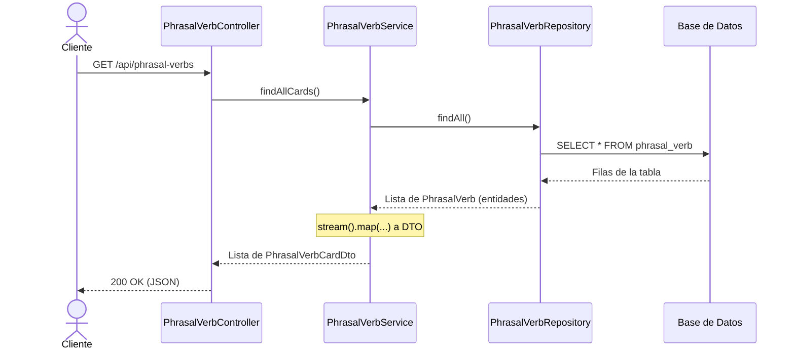
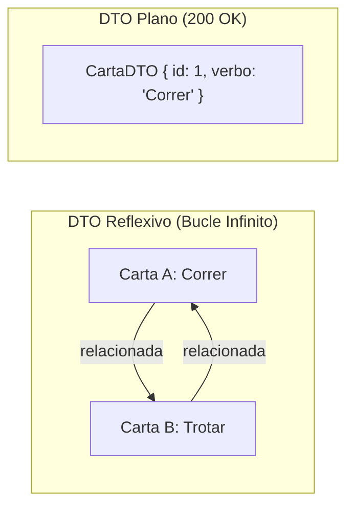

# 🃏 Phrasal Verbs Memory Game (Backend API)

API REST que alimenta un juego web de emparejamiento de cartas para aprender phrasal verbs en inglés (nivel B2) con 4 modos de juego: opuestos, sinónimos, traducción y huecos.

> **Estado:** en desarrollo. Infraestructura lista; modelo de datos en construcción.

## 🛠️ Stack

- Java 21
- Spring Boot 3.x (Web, Data JPA, Validation, Lombok)
- PostgreSQL 16
- Docker y Docker Compose
- Maven

## 📋 Requisitos previos

- JDK 21
- Docker Desktop
- Git
- Un IDE para Java (IntelliJ IDEA, VS Code…)

## ⚙️ Configuración

1. Copia la plantilla de variables de entorno:

   ```bash
   cp .env.example .env
   ```

2. Edita `.env` y rellena tus valores. Descripción de cada variable:

   | Variable | Descripción |
      |---|---|
   | `DB_NAME` | Nombre de la base de datos |
   | `DB_URL` | URL JDBC (`jdbc:postgresql://localhost:<puerto>/<DB_NAME>`) |
   | `DB_USER` | Usuario de PostgreSQL |
   | `DB_PASSWORD` | Contraseña de PostgreSQL |

   El puerto de `DB_URL` debe coincidir con el expuesto en `docker-compose.yml`.

3. Las variables de `.env` deben llegar a Spring como variables de entorno (`application.properties` las lee con `${DB_URL}`, `${DB_USER}`, etc.):

   - **En el IDE:** añade las variables en la configuración de ejecución de la aplicación (en IntelliJ: *Run > Edit Configurations > Environment variables*, o con un plugin como EnvFile apuntando a `.env`).
   - **Por terminal:** exporta las variables antes de arrancar:

     ```bash
     set -a && source .env && set +a
     ```

## 🚀 Puesta en marcha

1. Clona el repositorio:

   ```bash
   git clone https://github.com/BryanDZV/phrasal-verbs-backend.git
   cd phrasal-verbs-backend
   ```

2. Levanta PostgreSQL:

   ```bash
   docker compose up -d
   ```

3. Arranca la aplicación:

   ```bash
   ./mvnw spring-boot:run
   ```

   En Windows (PowerShell o CMD): `mvnw.cmd spring-boot:run`

## ✅ Cómo comprobar que funciona

En la consola debe aparecer un mensaje similar a `Started PhrasalgameApplication in X seconds` sin errores de conexión.

## 🧱 Fase de desarrollo

1. **Modelos (entidades JPA) y repositorios** (interfaces que extienden `JpaRepository`).
   - Se crea el modelo `PhrasalVerb` con sus atributos y relaciones.
2. **Repository** `PhrasalVerbRepository` para acceder a la base de datos.
   - La tabla `phrasal_verb` y sus columnas.
   - La relación reflexiva `opposite_id`.
   - Datos de prueba con `CommandLineRunner`.
   - Interfaz.
3. **DTO**: nos permite crear un objeto con solo los atributos que queremos exponer en la API.
   - Creamos `PhrasalVerbCardDto` para exponer solo el `id` y el `verb`.
   - Nota: usamos los Records de Java 21 para crear DTO inmutables y con menos código.
   - La manera tradicional es crear una clase con atributos privados, constructor, getters y setters.
4. **Service** `PhrasalVerbService` para encapsular la lógica de negocio.
   - Implementamos la lógica para convertir las entidades en DTO.
   - Interfaz y polimorfismo.
5. **Controller** `PhrasalVerbController` para exponer los endpoints REST.
   - Creamos el endpoint `GET /api/phrasal-verbs` para obtener todos los phrasal verbs.

## 🔄 Flujo de datos

1. El cliente hace una petición `GET` a la ruta `/api/phrasal-verbs`.
2. El controlador `PhrasalVerbController` recibe la petición y llama al método `findAllCards()` del servicio `PhrasalVerbService`.
3. El servicio `PhrasalVerbService` llama a `repo.findAll()` en el repositorio `PhrasalVerbRepository`.
4. El repositorio consulta la base de datos (vía JPA/Hibernate) y devuelve las entidades (`List<PhrasalVerb>`) al servicio.
5. El servicio transforma esas entidades en una lista de `PhrasalVerbCardDto` y se la devuelve al controlador.
6. El controlador devuelve la lista de `PhrasalVerbCardDto` al cliente en formato JSON.
7. El cliente recibe la respuesta y muestra los datos en la interfaz de usuario.



## 🌐 API

Endpoints disponibles:

- `GET /api/phrasal-verbs`: devuelve todos los phrasal verbs.

  Respuesta:

  ```json
  [
    { "id": 1, "verb": "put on" },
    { "id": 2, "verb": "take off" },
    { "id": 3, "verb": "turn on" },
    { "id": 4, "verb": "turn off" },
    { "id": 5, "verb": "give up" },
    { "id": 6, "verb": "look after" }
  ]
  ```

## ⚠️ Problemas encontrados

Los DTO complican el uso en relaciones reflexivas: si mapean todos los atributos de la entidad, al encontrar que se relaciona consigo misma se produce una recursión infinita que acaba en `StackOverflowError` o en una respuesta con niveles anidados de más, que no es lo que queremos.

**Solución:** crear un DTO con solo los atributos que queremos exponer, sin exponer la relación reflexiva.


Las cartas vienen con id consecutivos, cualquiera que entre en network puede verlas y hacer trampa, por eso en el juego web se barajan antes de mostrarlas.
**Solución:** implementar un mecanismo de barajado antes de devolver las cartas al cliente.

## 📝 Notas

- `spring.jpa.hibernate.ddl-auto` controla cómo Hibernate gestiona el esquema de la base de datos (por ejemplo `update` en desarrollo).